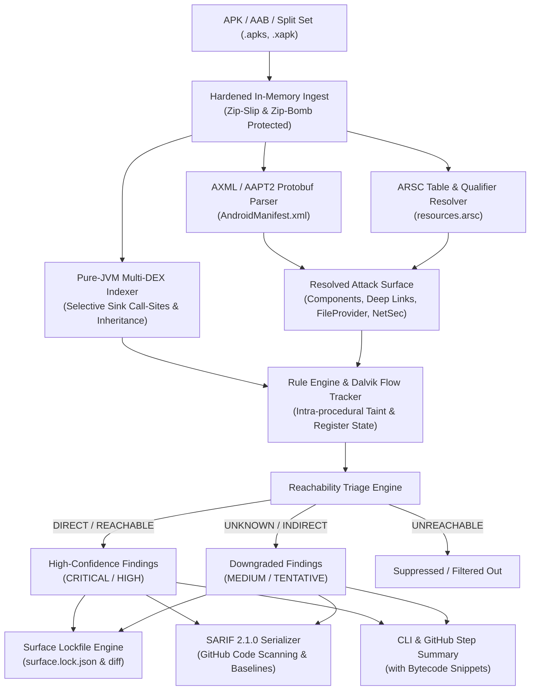

# APKwarden 🛡️

[](https://github.com/shaurya/apkwarden/actions/workflows/ci.yml)
[](LICENSE)
[](https://docs.oasis-open.org/sarif/sarif/v2.1.0/sarif-v2.1.0.html)
[](https://adoptium.net)
[](#installation)

> **Fast, reachability-first Android security analyzer.**  
> Zero cloud uploads, zero decompilation noise, PR attack surface diffing, and native SARIF 2.1.0 reporting.

---

## ⚡ Why APKwarden?

Traditional Android static security scanners (e.g. MobSF, whole-app JADX decompilers + Semgrep) were built for manual audits, not modern high-velocity CI/CD pipelines.

| Pain Point | Traditional Scanners | APKwarden |
| :--- | :--- | :--- |
| **Speed & Memory** | Decompiles whole APKs to 100,000+ `.java` files (10–30 mins, 4–8 GB heap). | **Direct Dalvik multi-DEX indexing** in memory (<60s, <2 GB heap). |
| **False Positives** | Flags dangerous calls in unexported, private, unreachable classes. | **Attack-surface reachability gating** (`DIRECT`, `REACHABLE`, `UNKNOWN`, `UNREACHABLE`). |
| **Confidentiality** | Requires uploading proprietary APKs to external cloud SaaS servers. | **100% Local & Zero-Cloud.** $0/month cost, zero code leaves your machine. |
| **Bundle & Split Support**| Relies on native `aapt2`/`bundletool` binaries that crash on ARM64 containers. | **Pure-JVM Protobuf & Split Cluster parser** (100% cross-platform). |
| **PR Regression Gating**| No attack surface tracking across pull requests. | **`surface.lock.json` & `apkwarden diff`** to catch unintended exports in PR diffs. |
| **CI Integration** | Ad-hoc HTML or JSON output requiring custom parsers. | **OASIS SARIF 2.1.0**, GitHub Code Scanning, Step Summaries, & Baseline Debt Suppression. |

---

## 🏗️ Architecture

APKwarden bypasses expensive source decompilation by analyzing compiled Dalvik bytecode (`classes*.dex`) directly alongside the resolved manifest and resource tables:



---

## 🚀 Quickstart Installation

### 1. Homebrew (macOS & Linux)
```bash
brew install shaurya/tap/apkwarden
```

### 2. Standalone Fat JAR (Universal)
Requires Java 17+:
```bash
# Download latest release
curl -sSL -O https://github.com/shaurya/apkwarden/releases/latest/download/apkwarden-all.jar

# Run directly
java -jar apkwarden-all.jar --help
```

### 3. Docker (Multi-Arch)
```bash
docker run --rm -v $(pwd):/workspace ghcr.io/shaurya/apkwarden:latest scan /workspace/app-release.apk
```

### 4. Build from Source
```bash
git clone https://github.com/shaurya/apkwarden.git
cd apkwarden
./bin/apkwarden --help
```

---

## 💻 CLI Commands

### 1. Full Security Scan (`scan`)
Performs static bytecode and attack-surface analysis using 21 high-precision AppSec rules:
```bash
apkwarden scan app-release.apk \
  --sarif results.sarif \
  --baseline .apkwarden-baseline.json \
  --fail-on HIGH
```
* `--sarif <file>`: Export full OASIS SARIF 2.1.0 report for GitHub Code Scanning / IDEs.
* `--baseline <file>`: Suppress grandfathered findings to avoid failing builds on legacy debt.
* `--generate-baseline <file>`: Generate a new baseline fingerprint file from current findings.
* `--fail-on <CRITICAL|HIGH|MEDIUM|LOW|NEVER>`: Exit with code 2 if active unsuppressed violations are found.

### 2. Attack Surface Lockfile (`lock`)
Generate a deterministic `surface.lock.json` mapping all exported components, deep links, permissions, FileProvider paths, and network security configs:
```bash
apkwarden lock app-release.apk -o surface.lock.json
```
Commit `surface.lock.json` to your git repository.

### 3. PR Attack Surface Diffing (`diff`)
Compare a new APK/AAB build against the committed lockfile to prevent accidental exposure regressions:
```bash
# Compare against checked out lockfile
apkwarden diff app-release.apk -b surface.lock.json

# Compare directly against protected base branch in CI
apkwarden diff app-release.apk --git-ref origin/main:surface.lock.json --fail-on-breaking
```
**Breaking Changes Caught:**
* 🚨 Exported Activity, Service, or Receiver added without permission guards.
* 🚨 Existing permission guard removed from an exported component.
* 🚨 Dangerous runtime permissions added (`CAMERA`, `RECORD_AUDIO`, `MANAGE_EXTERNAL_STORAGE`, etc.).
* 🚨 Cleartext HTTP traffic enabled in manifest or Network Security Config.
* 🚨 Trust in user-installed CA certificates enabled.
* 🚨 Domain certificate pinning removed.
* 🚨 Target SDK downgraded.

### 4. Attack Surface Inspection (`surface`)
Quickly inspect resolved components and permission guards without running a full bytecode scan:
```bash
apkwarden surface app-release.aab
```

### 5. Build Stack Fingerprinting (`fingerprint`)
Inspect build toolchains, packers, cross-platform frameworks, and blind spots:
```bash
apkwarden fingerprint app-release.apk
```

---

## 🤖 GitHub Actions Integration

Add APKwarden to your pull request workflow in 10 lines of YAML:

```yaml
name: Android Security Gate

on:
  pull_request:
    branches: [ main ]

permissions:
  contents: read
  security-events: write # Required for GitHub Code Scanning SARIF upload

jobs:
  security-audit:
    runs-on: ubuntu-latest
    steps:
      - uses: actions/checkout@v4
        with:
          fetch-depth: 0 # Full git history for base branch diffing

      - name: Set up JDK 17
        uses: actions/setup-java@v4
        with:
          java-version: '17'
          distribution: 'temurin'

      - name: Build Android Release APK
        run: ./gradlew assembleRelease

      # 1. Diff attack surface against base branch
      - name: Verify Attack Surface Drift
        uses: shaurya/apkwarden@v1
        with:
          target: app/build/outputs/apk/release/app-release.apk
          command: diff
          git-ref: origin/main:surface.lock.json
          fail-on-breaking: 'true'

      # 2. Run static security scan with SARIF reporting
      - name: Run APKwarden Security Scan
        uses: shaurya/apkwarden@v1
        with:
          target: app/build/outputs/apk/release/app-release.apk
          command: scan
          sarif-file: apkwarden-results.sarif
          baseline-file: .apkwarden-baseline.json
          fail-on: HIGH
          upload-sarif: 'true'
```

---

## 🎯 Rule Registry (21 High-Precision Rules)

| Rule ID | Severity | Name | CWE | OWASP | Reachability Gate |
| :--- | :--- | :--- | :--- | :--- | :--- |
| `APK-SEC-001` | **CRITICAL** | Exported Component Vulnerable to Intent Redirection | CWE-926 | M4 | `DIRECT` / `REACHABLE` |
| `APK-SEC-002` | **HIGH** | Mutable PendingIntent Created | CWE-926 | M4 | `DIRECT` / `REACHABLE` |
| `APK-SEC-003` | **MEDIUM** | PendingIntent with Implicit Intent | CWE-926 | M4 | Component Scoped |
| `APK-SEC-004` | **HIGH** | JavaScript Interface Injected into WebView | CWE-749 | M1 | `DIRECT` / `REACHABLE` |
| `APK-SEC-005` | **HIGH** | Universal File Access Enabled in WebView | CWE-200 | M1 | `DIRECT` / `REACHABLE` |
| `APK-SEC-006` | **CRITICAL** | Arbitrary URL Loading via Untrusted Intent | CWE-926 | M4 | `DIRECT` / `REACHABLE` |
| `APK-SEC-007` | **CRITICAL** | Insecure SSL Error Handling (`handler.proceed`) | CWE-295 | M2 | Global Sink |
| `APK-SEC-008` | **HIGH** | Dynamic Receiver Registered without Export Flag | CWE-926 | M4 | Component Scoped |
| `APK-SEC-009` | **MEDIUM** | Sticky Broadcast Sent | CWE-926 | M4 | Global Sink |
| `APK-SEC-010` | **MEDIUM** | Fragile Deep Link Host Validation | CWE-20 | M4 | Deep Link Scoped |
| `APK-SEC-011` | **HIGH** | Insecure Cipher Mode (ECB) | CWE-327 | M2 | Global Sink |
| `APK-SEC-012` | **CRITICAL** | Hardcoded Private Key in Bytecode | CWE-798 | M1 | Constant Pool |
| `APK-SEC-013` | **HIGH** | Static Cryptographic IV Reused | CWE-329 | M2 | Global Sink |
| `APK-SEC-014` | **HIGH** | World-Readable Shared Preferences Created | CWE-732 | M1 | Component Scoped |
| `APK-SEC-015` | **CRITICAL** | FileProvider Root Path (`<root-path>`) Exposed | CWE-22 | M1 | Manifest / XML |
| `APK-SEC-016` | **HIGH** | Dirty Stream Path Traversal in File Writing | CWE-22 | M1 | `DIRECT` / `REACHABLE` |
| `APK-SEC-017` | **HIGH** | Hardcoded AWS Access Key ID Detected | CWE-798 | M1 | Constant Pool |
| `APK-SEC-018` | **HIGH** | Hardcoded Generic Cloud API Token Detected | CWE-798 | M1 | Constant Pool |
| `APK-SEC-019` | **CRITICAL** | Application is Debuggable | CWE-215 | M1 | Manifest |
| `APK-SEC-020` | **HIGH** | Application Allows Unencrypted Backup | CWE-311 | M1 | Manifest |
| `APK-SEC-021` | **HIGH** | Cleartext HTTP Traffic Permitted | CWE-319 | M2 | Manifest / NetSec |

---

## 🔬 Reachability Methodology

Traditional scanners report hundreds of "vulnerabilities" by matching regex patterns on private helper classes (e.g. `Utils.startActivity` or `Crypt.decrypt`). In 90% of cases, these methods are called exclusively with static parameters from internal code, making them completely unexploitable by external attackers.

APKwarden employs a **two-phase reachability evaluation**:
1. **Attack Surface Resolution:** Identifies true entry points that third-party applications can reach (`exported=true`, intent filters, deep links).
2. **Reverse Call-Graph Traversal:** Resolves the call chain from dangerous sinks (e.g. `startActivity`, `loadUrl`, `Cipher.init`) backwards through caller hierarchies up to 6 hops:
   * **`DIRECT`**: Sink is invoked directly inside an exported component lifecycle (`onCreate`, `onReceive`, etc.). Severity: **CRITICAL / HIGH**.
   * **`REACHABLE`**: Statically proven reachable from an exported component via inter-method call graph. Severity: **CRITICAL / HIGH**.
   * **`UNKNOWN`**: Sink is invoked in indirect application code (e.g. ViewModel, Dagger injected service), but call path cannot be statically verified. Downgraded to **MEDIUM / TENTATIVE**.
   * **`UNREACHABLE`**: Component is explicitly unexported with zero exported callers. **Suppressed**.

---

## 📄 License & Attribution

APKwarden is licensed under the [Apache License, Version 2.0](LICENSE).
Built with [dexlib2](https://github.com/google/smali), [Clikt](https://ajalt.github.io/clikt/), and Kotlin.
